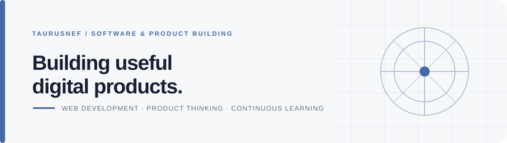

  

  <strong>Web development · Product thinking · Continuous learning</strong>

I enjoy turning practical ideas into focused web experiences — from learning tools and creative utilities to customer-facing portals. My approach is simple: make the interface clear, solve a real problem, and keep the code maintainable.

---

## Selected work

<table>
  <tr>
    <td width="33%" valign="top">
      <strong>01 / LEARNING</strong>
      <h3>JPNLearning</h3>
      
A self-paced Japanese learning platform for JLPT N5, with lessons, listening practice, smart review, and timed exercises.

      Next.js · React · TypeScript
    </td>
    <td width="33%" valign="top">
      <strong>02 / CREATIVE TOOLING</strong>
      <h3>StoryBatch Studio</h3>
      
A browser-based batch editor for turning product photos into consistent 9:16 designs, with editable text and ZIP export.

      Next.js · React · JSZip · Canvas API
    </td>
    <td width="33%" valign="top">
      <strong>03 / CUSTOMER EXPERIENCE</strong>
      <h3>Omisora.JPN Web</h3>
      
A customer order-tracking portal for order status, payment summaries, trip details, and shipping updates.

      Next.js · React · TypeScript · Tailwind CSS
    </td>
  </tr>
</table>

Project source repositories are currently private.

## Technology

  
  
  
  
  
  

**Other tools and browser capabilities:** Canvas API · Local Storage · Web Speech API · JSZip · Git

## Current approach

- Build around real workflows and practical needs.
- Keep interfaces focused, accessible, and responsive.
- Prefer reusable components and clear documentation.
- Improve projects through small, deliberate iterations.

---

  Thanks for visiting · <a href="https://github.com/taurusnef">github.com/taurusnef</a>

